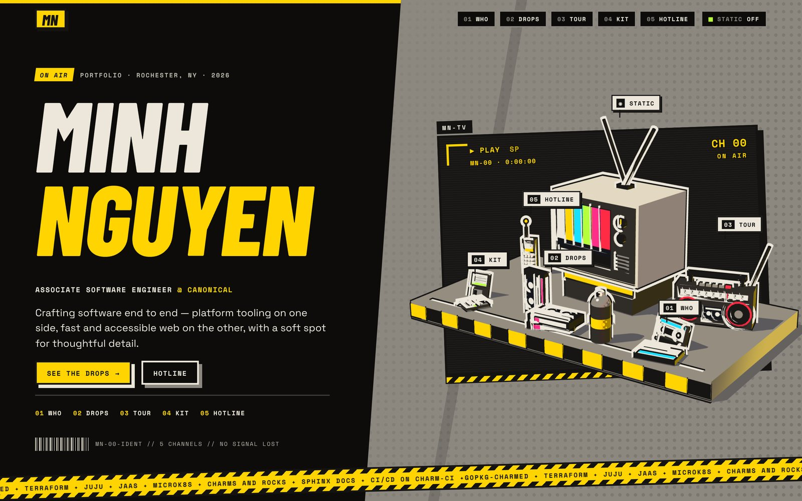

# Minh Nguyen — portfolio

A fast, street-styled portfolio: colour-blocked panels, big type, hazard tape and
stickers, with a cel-shaded 3D desk whose objects lead to the sections.



## Run it

```bash
npm install
```

```bash
npm run dev
```

| Script | What it does |
|---|---|
| `npm run dev` | Dev server |
| `npm run build` | Writes the static site to `dist/` |
| `npm run preview` | Serves the built site |
| `npm test` | Runs the tests (builds first; browser tests need Playwright) |
| `npm run icons` | Regenerates `public/icons.svg` after changing the logo list |

Vite 8.3.6 requires Node `^20.19.0 || >=22.12.0` (from its `package.json`).
Built and tested with Node 22.23.4 and three 0.187.0.

## Check the speed on your own machine

Open the site with `?perf` added to the address, for example
`http://localhost:5173/?perf`. A small readout shows when the first text appeared,
when the 3D scene was ready, how many frames have been drawn, and the slowest frame
during the last transition (16.7 ms is 60 fps).

## How it stays fast

The previous versions were slow for two measured reasons: a post-processing chain
that redrew a Retina-sized canvas 18 to 27 times per frame and never stopped
drawing, and a 13 MB icon library downloaded in dev mode. This version is built
around not doing that work.

- **Text first.** All content is plain HTML and CSS. It is on screen before any
  script runs: about 4 KB of HTML, 5 KB of CSS and 2 KB of script, compressed.
- **3D afterwards.** three.js is a separate download that starts once the page is
  up. If it fails, or the browser has no WebGL, the page is still complete.
- **One pass.** The scene is drawn with three small shaders and no
  post-processing, shadow maps or textures.
- **Only when something changes.** A frame is drawn on a section change, a hover,
  a pointer move or a resize. Sitting still, the 3D scene draws nothing, and away
  from the opening screen nothing on the page animates at all.
- **Bounded resolution.** On high-density screens the canvas is capped at 2x and
  about 4.5 megapixels. It never drops below the display's own 1x resolution, so a
  very large 1x window (a 4K monitor at 100%) draws more than that.
- **No icon library at run time.** The logos are a 42 KB static SVG file.

Measured in headless Chromium at 1512 x 982, 2x (a 14-inch MacBook Pro at default
scaling). The test machine has no GPU, so these count the work asked of the GPU,
not frame times:

| | `main` | `rpg-theme` | this branch |
|---|---|---|---|
| Render passes per frame | 18 | 27 | 1 |
| Megapixels shaded per frame | 23.9 | 51.3 | 4.5 |
| Draw calls per frame | 64 | 141 | 21 |
| Shader programs compiled | 30 | 40 | 3 |
| Frames drawn while idle | every frame | every frame | 0 |
| Script up front (gzip) | 274 KB | 295 KB | 2.4 KB |
| Script in total (gzip) | 274 KB | 295 KB | about 171 KB, 21 KB of it only when a model file is configured |
| Script downloaded in dev mode | not measured | 22.2 MB | 6.6 MB |

`npm test` enforces these as limits, so a change that brings the cost back fails.

## Theme rules

Urban street poster with a retro-futuristic edge. Keep these and new work will match.

**Colour.** Stark neutrals plus a few loud accents, all defined in
`src/styles/tokens.css`.

| Token | Use |
|---|---|
| `--ink` `#0b0b0c`, `--paper` `#f2efe6` | The two neutrals. Most of every screen |
| `--yellow` `#ffd400` | Hazard yellow: the lead accent, tape, highlights on ink |
| `--magenta` `#ff2e88` | Electric magenta: second accent, highlights on paper |
| `--crimson` `#c81e36` | One block only (Tour) |
| `--lime` `#b6ff3c` | Neon: keyboard focus and hover outlines, nothing else |

Colour is used in flat blocks with hard edges. No gradients, glows, blurs or soft
shadows. Shadows are solid offsets. One accent leads each section.

**Type.**

| Font | Use |
|---|---|
| Anton | Headlines, upper case, tight |
| Chakra Petch | Labels, numbers, buttons, anything small and upper case |
| Space Grotesk | Sentences |

**Shapes.** Slanted block edges, 3 px ink borders, stickers a degree or two off
level, hazard stripes for emphasis.

**3D.** Clean ink outlines of a fixed pixel width; two flat tones per colour with a
hard edge and halftone dots where they meet; bounce light tinted by the section's
colour; a warm band at the edge of the shadow (the subsurface look); one hard
highlight; flat shadows. On the black sections the lines switch to neon.

**Words.** Short and plain. Streetwear terms only where they name a real thing:
projects are drops, open-source contributions are collabs, experience is a tour,
technologies are the kit. Every fact on the page is real.

**Motion.** Quick and deliberate: a slanted wipe between sections, a short camera
settle, the ring turning one step, buttons that shift on their shadow. The only
thing that loops is the tape on the opening screen, and `prefers-reduced-motion`
turns all of it off.

## Where things live

| File | What it holds |
|---|---|
| `index.html` | All the content |
| `src/styles/` | `tokens.css` (palette and fonts), `base.css`, `art.css` (the fixed art layer), `layout.css`, `components.css` |
| `src/main.js` | Active section, art-layer switch, lazy start of the scene |
| `src/config/scene.config.js` | Objects on the desk and how each section frames them |
| `src/scene/scene.js` | Renderer, camera, hover and click, drawing on demand |
| `src/scene/toon.js` | The three shaders: toon, outline, flat shadow |
| `src/scene/objects.js` | The stand-in objects |
| `src/scene/loader.js` | Turns a config entry into geometry, from a placeholder or a model file |
| `src/lib/` | Small pure functions, unit tested |
| `scripts/build-icons.mjs` | Generates `public/icons.svg` |
| `tests/` | Unit, content and browser tests |
| `docs/superpowers/` | The design and plan for this rebuild |

## Swap a placeholder for a real model

1. Put the file in `public/models/`, for example `public/models/mug.glb`.
2. In `src/config/scene.config.js`, set that object's `model` to its path inside
   `public/`. The path is read as inside the site's own folder, so it also works
   when the site is hosted in a sub-folder such as a GitHub Pages project site:

   ```js
   { id: 'mug', model: '/models/mug.glb', placeholder: 'mug', fit: 0.13, ... }
   ```

The model is scaled so its largest side equals `fit` (metres), centred, and stood
on the desk. It is drawn in the site's style: each part keeps its base colour
(multiplied by its vertex colours, if it has them) and gets the outline and flat
shadow. **Its textures are not used.** A model whose detail lives only in its texture will look plain; that is the
known limit of this version. If the file cannot be loaded, the placeholder is used.

Files compressed with `npx @gltf-transform/cli optimize` load as they are (checked
with version 4.5.1, whose default is meshopt compression). Draco-compressed files are
not supported.

For a character model, raise `sss` on its entry (for example `sss: 0.8`) to
strengthen the warm band at the shadow edge.

## Add an object or a section

1. Add an entry to `objects` in `scene.config.js`. Give it `section` to make it
   clickable. With no model, add a builder of the same name to `src/scene/objects.js`.
2. For a new section, add a `<section>` to `index.html` with `id`, `data-accent`
   (`yellow`, `magenta`, `paper` or `ink`), `data-side` (`left` or `right`: where the
   art shows), `data-word` (the giant word) and `data-focus`; add it to the menu and
   to the menu-highlight rule in `layout.css`; and add a view with the same id to
   `views` in `scene.config.js`.

## Screens and accessibility

- Tested for fit at 360x640, 390x844, 768x1024, 1024x768, 1280x720, 1366x768,
  1440x900, 1920x1080 and 2560x1080.
- Below 860 px wide the art sits above the text.
- All content works with the keyboard, with JavaScript off, and without WebGL.
- Keyboard focus is a two-colour ring (ink inside, neon outside), so it shows on
  every background.
- Text meets WCAG AA contrast against its block; the tests check both.
- `prefers-reduced-motion` stops every animation.

## Branches

| Branch | What it is |
|---|---|
| `street` | This version |
| `main`, `after-hours-v1` | The night desk with the particle swarm |
| `rpg-theme` | The night desk with the RPG-log layer |

## Not done

- The desk objects are stand-ins. No AI-generated models exist yet: the cloud GPU
  session never ran and nothing was spent (see `COSTS.md`).
- No characters, so the subsurface term is only visible as a subtle band on objects.
- Real frame rates on a real GPU have not been measured; use `?perf`.
- Not deployed anywhere.

## Licences of what is bundled

three (MIT); Anton, Chakra Petch and Space Grotesk via Fontsource (OFL-1.1); logo
outlines from simple-icons (CC0-1.0 data; the logos remain trademarks of their
owners and are used here only to name technologies).
