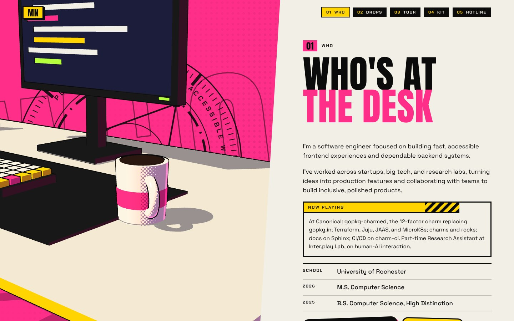
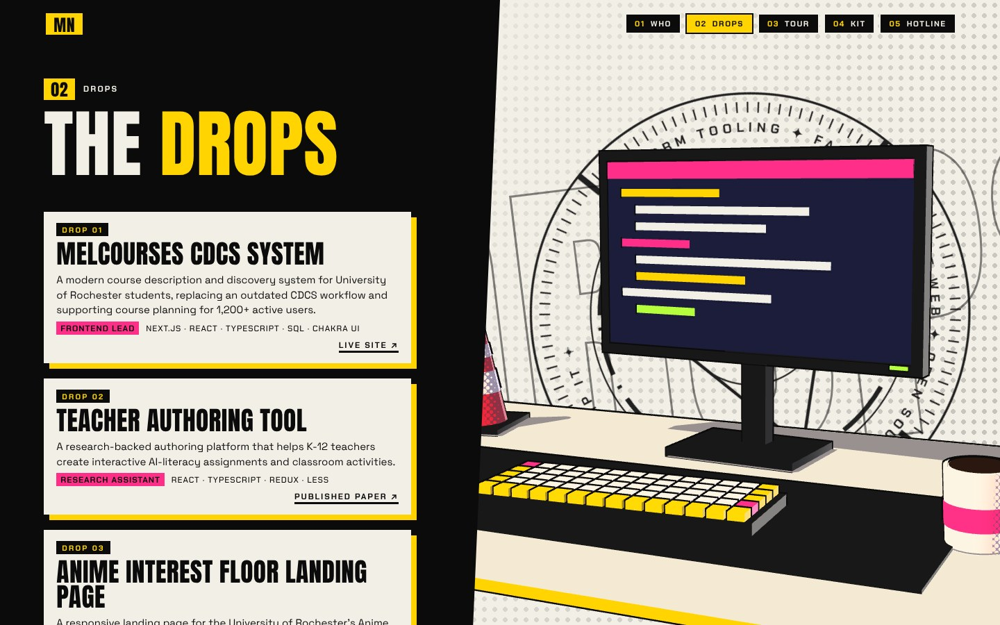
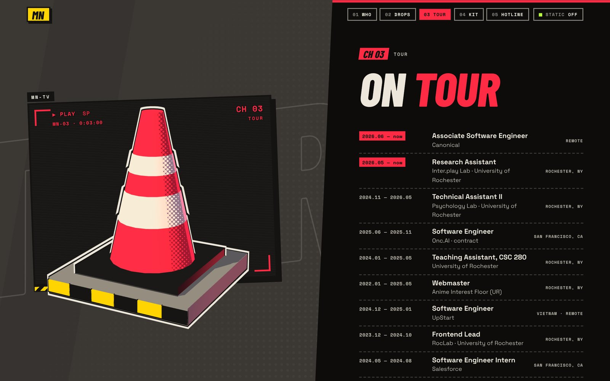
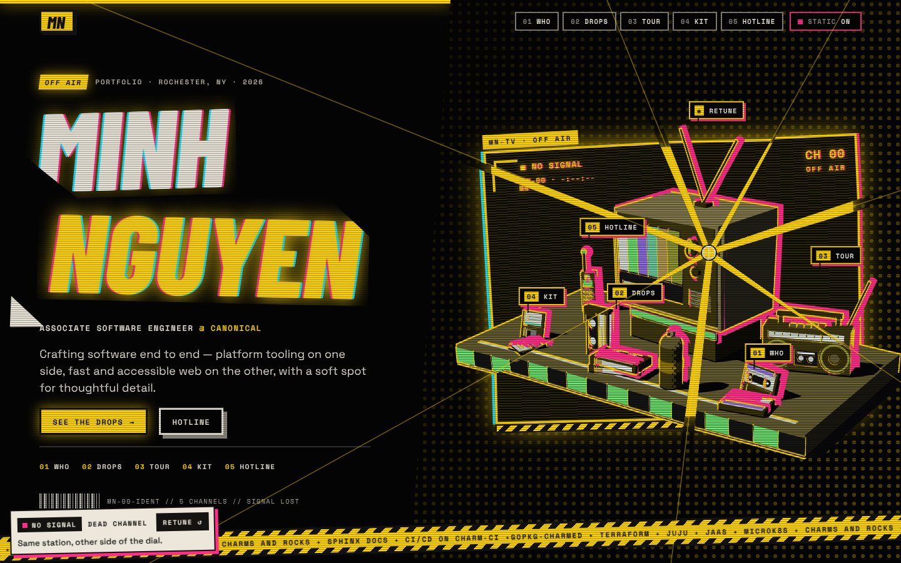
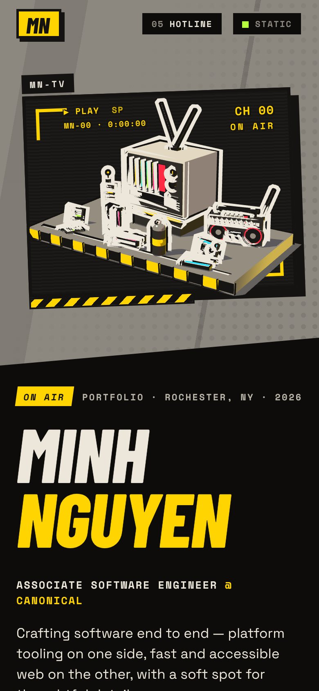

# Minh Nguyen — portfolio

A fast portfolio styled as a pirate TV station: every section is a channel with its
own accent colour, the 3D objects are cel-shaded stickers that break out of a screen
frame, and a switch tunes the whole page to a dead channel called Static.


| | |
|---|---|
|  |  |
|  |  |

## Run it

```bash
npm install
```

```bash
npm run dev
```

| Script | What it does |
|---|---|
| `npm run dev` | Dev server |
| `npm run build` | Writes the static site to `dist/` |
| `npm run preview` | Serves the built site |
| `npm test` | Runs the tests (builds first; browser tests need Playwright) |
| `npm run icons` | Regenerates `public/icons.svg` after changing the logo list |

Vite 8.3.6 requires Node `^20.19.0 || >=22.12.0` (from its `package.json`).
Built and tested with Node 22.23.4 and three 0.187.0.

## Check the speed on your own machine

Open the site with `?perf` added to the address, for example
`http://localhost:5173/?perf`. A small readout shows when the first text appeared,
when the 3D scene was ready, how many frames have been drawn, and the slowest frame
during the last transition (16.7 ms is 60 fps).

## How it stays fast

The first two versions were slow for two measured reasons: a post-processing chain
that redrew a Retina-sized canvas 18 to 27 times per frame and never stopped
drawing, and a 13 MB icon library downloaded in dev mode. This version keeps the
rules that fixed that.

- **Text first.** All content is plain HTML and CSS. It is on screen before any
  script runs: about 5 KB of HTML, 7 KB of CSS and 4 KB of script, compressed.
- **3D afterwards.** three.js is a separate download that starts once the page is
  up. If it fails, or the browser has no WebGL, the page is still complete.
- **One pass.** The scene is drawn with three small shaders and no
  post-processing, shadow maps or textures. The Static look, the broken picture
  included, is part of those same shaders.
- **Only when something changes.** A frame is drawn on a section change, the Static
  switch, a hover, a click, a pointer move or a resize. Sitting still, the 3D scene
  draws nothing, and away from the opening screen nothing on the page animates.
  Scanlines and glows are still pictures, not animations.
- **Bounded resolution.** On high-density screens the canvas is capped at 2x and
  about 4.5 megapixels. It never drops below the display's own 1x resolution, so a
  very large 1x window (a 4K monitor at 100%) draws more than that.
- **No icon library at run time.** The logos are a static SVG file.

Measured in headless Chromium at 1512 x 982, 2x (a 14-inch MacBook Pro at default
scaling). The test machine has no GPU, so these count the work asked of the GPU,
not frame times:

| | `main` | `rpg-theme` | this branch |
|---|---|---|---|
| Render passes per frame | 18 | 27 | 1 |
| Megapixels shaded per frame | 23.9 | 51.3 | 4.5 |
| Draw calls per frame | 64 | 141 | 31 on the opening view, 7 on a channel; seven times that in Static mode |
| Shader programs compiled | 30 | 40 | 3 |
| Frames drawn while idle | every frame | every frame | 0, in Static mode too |
| Script up front (gzip) | 274 KB | 295 KB | 4.2 KB |
| Script in total (gzip) | 274 KB | 295 KB | about 176 KB, 21 KB of it only when a model file is configured |

`npm test` enforces these as limits, so a change that brings the cost back fails.

## Theme rules

Urban fantasy seen through analog media: a world made of packaging, signage,
posters and tape labels, played back on a CRT. Keep these and new work will match.

**Colour, in two layers.** The page's palette is defined in `src/styles/tokens.css`.
The 3D objects carry the same colours in `src/scene/objects.js`, and `static.css`
adds the deeper blacks of the other-world mode.

| Layer | Tokens | Use |
|---|---|---|
| Base | `--black` `#0d0c0b`, `--char` `#1d1b19`, `--concrete` `#8c8880`, `--paper` `#ece7da`, `--ink` `#141312` | Every large surface. Low saturation, and never pure `#000` or `#fff` |
| Accent | `--yellow` `#ffd400`, `--cyan` `#19e0ff`, `--magenta` `#ff2e88`, `--crimson` `#ff2a44`, `--acid` `#b6ff3c` | Small, flat, fully saturated: a label, a rule, one word, one sticker |

Each section owns one accent, named by `data-accent` on its `<section>`: intro
yellow, Who cyan, Drops magenta, Tour crimson, Kit acid green, Hotline yellow.
Block backgrounds are base tones only; the tests fail a block whose background is
an accent.

**Static, the other-world mode.** The switch in the top bar (or a click on the
television) sets `data-world="static"` on `<html>`. Everything in
`src/styles/static.css` then applies: deep black, accents that glow, outlines split
into two colours, scanlines over the page. This is the only place glow is allowed.

Static is a cracked screen, and it is meant to look broken. What keeps it from
looking like a fault is that the damage is plainly drawn:

| | How |
|---|---|
| One pattern, the same every time | Seven straight cracks run from one point of impact, marked with a ring and a cross. `src/lib/fracture.js` holds the pattern |
| Rigid pieces, clean cuts | The screen frame and the 3D picture are cut along the same cracks into wedges. Each wedge moves a little outward and turns slightly, and stays in one piece |
| Light in the gaps | A plate in the channel's accent sits behind the pieces and shows only between them |
| The whole page shares the break | The cracks carry on across the page as thin lines. Headlines break into their words, each knocked out of line with a corner gone and that corner lying below it. Cards sit slightly out of true |
| It breaks, then holds | The pieces fit together under a burst of static with a large NO SIGNAL, then snap apart with a little overshoot. After that nothing moves |
| The world rewords itself | The display reads `NO SIGNAL` with no time code, the station tab and the opening label read `OFF AIR`, and the television's label changes from Static to Retune |
| A note names it | A strip of paper tape, the one clean thing on the page: `NO SIGNAL · DEAD CHANNEL`, a Retune button, and for the first seven seconds one line in the station's voice |
| Screen readers are told plainly | A status message says the mode is on, that it is on purpose, and how to turn it off |

The 3D scene breaks without an extra pass: it is drawn once per piece into the same
canvas, each time moved as one rigid sheet and trimmed to its wedge by the same three
shaders. Clicks are traced back through the piece under the pointer, so an object is
still found where it is drawn.

Wording that differs between the modes is in the page twice, marked `when-clean` and
`when-static`; the stylesheet shows one.

**Graphic language.** Hazard stripes, tape, sticker labels, stamped serial numbers,
barcodes, halftone dots, a comic speech panel, slanted block edges, CRT scanlines.
Edges are hard: shadows are solid offsets, and there is no blur or glass.

**Type.**

| Font | Use |
|---|---|
| Barlow Condensed 800 italic | Headlines: big, tight, upper case, sometimes knocked out of an accent block |
| Space Mono | Labels, serials, dates, buttons, on-screen display |
| Space Grotesk | Sentences |

**3D.** Ink outlines of a fixed pixel width, plus a wider paper edge behind them so
each object reads as a die-cut sticker. Three flat tones with hard edges, halftone
dots where light meets shadow, rim and bounce light in the section's accent, a warm
band at the shadow edge (the subsurface look), one hard highlight, flat shadows.
The opening view shows the whole set; every other channel features one object by
itself on a small hazard-striped stand, sized to overlap the screen frame.

**Motion.** Snappy. A section change is a channel flip: a burst of static with
tracking bars, a picture roll, then the featured object pops in past full size and
settles. Buttons and stickers overshoot; a clicked object squashes and springs
back. Animations that move the same thing replace one another instead of racing. The only thing that loops is the tape on the opening screen, and
`prefers-reduced-motion` turns all of it off.

**Words.** Short and plain. Projects are drops, open-source contributions are
collabs, experience is a tour, technologies are the kit, contact is the hotline.
Every fact on the page is real.

**Names.** Nothing here is taken from an existing game or brand: no names, logos,
characters or interface layouts. The other-world mode is called Static for that
reason.

## Where things live

| File | What it holds |
|---|---|
| `index.html` | All the content, and each section's channel, accent and side |
| `src/styles/` | `tokens.css` (palette and fonts), `base.css`, `art.css` (the fixed art layer: wall, screen frame, display, channel flip), `layout.css`, `components.css`, `static.css` (the other-world mode) |
| `src/main.js` | Active section, channel flip, the Static switch, lazy start of the scene |
| `src/config/scene.config.js` | The objects on the set and what each channel shows |
| `src/scene/scene.js` | Renderer, camera, featured objects, hover and click, drawing on demand |
| `src/scene/toon.js` | The three shaders: toon, outline, flat shadow |
| `src/scene/objects.js` | The stand-in objects and the slab |
| `src/scene/loader.js` | Turns a config entry into geometry, from a placeholder or a model file |
| `src/lib/` | Small pure functions, unit tested |
| `scripts/build-icons.mjs` | Generates `public/icons.svg` |
| `tests/` | Unit, content and browser tests |
| `docs/superpowers/specs/` | The design notes for this version and the one before |

## Swap a placeholder for a real model

1. Put the file in `public/models/`, for example `public/models/cassette.glb`.
2. In `src/config/scene.config.js`, set that object's `model` to its path inside
   `public/`. The path is read as inside the site's own folder, so it also works
   when the site is hosted in a sub-folder such as a GitHub Pages project site:

   ```js
   { id: 'cassette', model: '/models/cassette.glb', placeholder: 'cassette', fit: 0.3, ... }
   ```

The model is scaled so its largest side equals `fit` (metres), centred, and stood
on the slab. It is drawn in the site's style: each part keeps its base colour
(multiplied by its vertex colours, if it has them) and gets the outlines and flat
shadow. **Its textures are not used.** A model whose detail lives only in its
texture will look plain; that is the known limit of this version. If the file
cannot be loaded, the placeholder is used.

Files compressed with `npx @gltf-transform/cli optimize` load as they are (checked
with version 4.5.1, whose default is meshopt compression). Draco-compressed files
are not supported.

For a character model, raise `sss` on its entry (for example `sss: 0.8`) to
strengthen the warm band at the shadow edge.

## Add an object, a channel, or change what a channel shows

1. **Object.** Add an entry to `objects` in `scene.config.js`. Give it `section` to
   make it lead to a section when clicked on the opening view. With no model, add a
   builder of the same name to `src/scene/objects.js`.
2. **What a channel shows.** In `views`, a section either shows the whole set
   (`camera` and `target`) or features one object by itself:

   ```js
   about: { feature: 'cassette', from: [24, 22], fill: 0.6 },
   ```

   `from` is the direction it is seen from, as `[turn, tilt]` in degrees; `fill` is
   how much of the view's height it takes up. The stand is made to fit the object.
3. **Channel.** Add a `<section>` to `index.html` with `id`, `data-accent` (`yellow`,
   `cyan`, `magenta`, `crimson` or `acid`), `data-channel` (two digits), `data-name`
   (shown on the display), `data-side` (`left` or `right`: where the art shows)
   and `data-word` (the giant word behind the screen); add it to the menu and to
   the menu-highlight rule in `layout.css`; and add a view with the same id to
   `views`.

## Screens and accessibility

- Tested for fit at 360x640, 390x844, 768x1024, 1024x768, 1280x720, 1366x768,
  1440x900, 1920x1080 and 2560x1080.
- Below 860 px wide the art sits above the text.
- All content works with the keyboard, with JavaScript off, and without WebGL.
- The Static switch is a real button with one fixed name ("Static mode") that reports
  its state (`aria-pressed`). Turning it on is announced, and the Retune button in the
  note hands the keyboard back to the switch.
- Keyboard focus is a two-colour ring in both modes, so it shows on every background.
- Text meets WCAG AA contrast against its block in both modes; the tests check both.
- `prefers-reduced-motion` stops every animation, the channel flip included.



## Branches

| Branch | What it is |
|---|---|
| `channel` | This version |
| `street` | The version before: same speed rules, full colour blocks, a desk scene |
| `main`, `after-hours-v1` | The night desk with the particle swarm |
| `rpg-theme` | The night desk with the RPG-log layer |

## Not done

- The objects are stand-ins built from simple shapes. No AI-generated models exist
  yet: the cloud GPU session never ran and nothing was spent (see `COSTS.md`).
- No characters, so the subsurface term is only visible as a subtle band on objects.
- No sound, and one page only: "transitions between pages" in the brief is read as
  transitions between sections.
- Real frame rates on a real GPU have not been measured; use `?perf`.
- Not deployed anywhere.

## Licences of what is bundled

three (MIT); Barlow Condensed, Space Mono and Space Grotesk via Fontsource
(OFL-1.1); logo outlines from simple-icons (CC0-1.0 data; the logos remain
trademarks of their owners and are used here only to name technologies).
