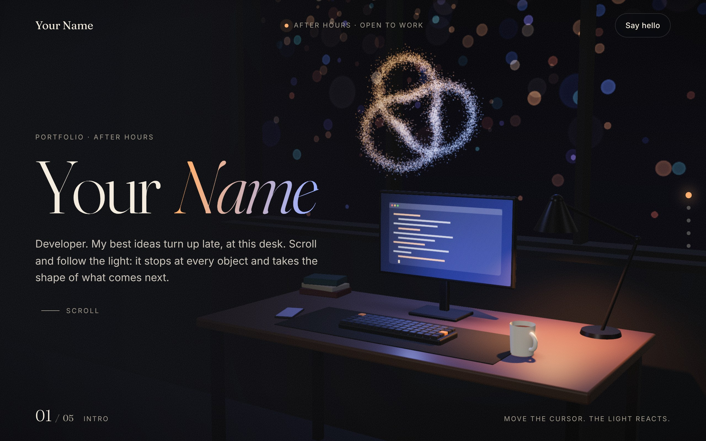

# Desk portfolio — "After hours"

A portfolio site where scrolling moves a camera across a desk at night. A swarm
of light particles hovers over the desk, follows the visitor from object to
object, and takes a different shape at each stop.



## Run it

```bash
npm install
```

```bash
npm run dev
```

Other scripts: `npm run build` writes the static site to `dist/`, and
`npm run preview` serves that build locally.

Vite 8.3.6 requires Node `^20.19.0 || >=22.12.0` (from its `package.json`).
Built and tested with Node 22.23.4, three 0.187.0, gsap 3.15.1 and lenis 1.3.27.

## Where things live

| File | What it holds |
|---|---|
| `index.html` | All the words: name, sections, projects, links |
| `src/config/scene.config.js` | Objects, camera stops and swarm shapes. The one file to edit for scene changes |
| `src/style.css` | Colours, type and layout. Theme colours are the variables at the top |
| `src/scene/stage.js` | Room, window, lamp, lights and post-processing |
| `src/scene/swarm.js`, `shapes.js` | The particle swarm and the shapes it can form |
| `src/scene/loader.js` | The single loader for placeholders and `.glb` models |
| `src/scene/placeholders.js` | Stand-in shapes used until real models exist |
| `src/scroll.js` | Scroll position → camera path, active section |
| `src/interact.js` | Pointer: camera drift, swarm reaction, hover and click on objects |
| `src/reveal.js` | Line-by-line text reveals |

## Make it yours

1. Replace "Your Name", the copy and the links in `index.html`.
2. Change the particle text shapes in `scene.config.js` if you like (for
   example your initials instead of `hi`).

## Swap a placeholder for a real model

1. Put the compressed file in `public/models/`, for example `public/models/mug.glb`.
2. In `src/config/scene.config.js`, set that object's `model`:

   ```js
   { id: 'mug', model: '/models/mug.glb', placeholder: 'mug', fit: 0.12, ... }
   ```

The loader rescales the model so its largest side equals `fit` (metres), centres
it and stands it on the desk. If the file fails to load, the placeholder is used
instead. Models compressed with `npx @gltf-transform/cli optimize` load as they
are: that tool's default geometry compression is meshopt (checked against
version 4.5.1), and the loader registers the matching decoder.

## Add a new object

1. Add an entry to `objects` in `scene.config.js` (`id`, `model`, `placeholder`,
   `fit`, `position`, `rotationY`). With no model yet, add a builder of the same
   name to `src/scene/placeholders.js`.
2. Add an entry to `stops` with the camera position, the point it looks at, the
   text side, and a `swarm` shape.
3. Add a matching `<section data-stop="...">` to `index.html`, plus a dot in the
   `<nav class="dots">` list, and add the new name to the dot-highlight rule in
   `src/style.css`.

## Swarm shapes

Each stop's `swarm` picks a shape: `knot`, `helix`, `sphere`, or `text` with any
characters and font. `at` is the centre, `size` the radius in metres, `spin`
optional slow rotation, and `glow` an optional brightness multiplier.

## Devices and accessibility

- **Desktop:** full scene with bloom, shadows, smooth scrolling, pointer effects.
- **Phones and small tablets:** fewer particles, no shadows or bloom, and the
  camera eases between stops instead of following every scroll movement.
- **`prefers-reduced-motion`:** the camera jumps between stops, the swarm stands
  still, and text appears without animation.
- **No WebGL:** the page falls back to plain, readable HTML.
- **Slow frame rates:** resolution drops in steps, then bloom is switched off.
  Add `?q=high` to the address to pin full quality.

## 3D models: status

All objects are still placeholders. The planned cloud GPU session never ran: the
credit expired before a provider was confirmed, so nothing was created and
nothing was spent (see `COSTS.md`). The remaining route is a free hosted
image-to-3D demo, then `gltf-transform optimize`, then the swap described above.
Source photos go in `assets/source/`: one object per photo, three-quarter view,
plain background, soft even light.

## Licences of what is bundled

three (MIT), lenis (MIT), Fraunces and Inter via Fontsource (OFL-1.1), and GSAP
under its standard "no charge" licence (https://gsap.com/standard-license).
